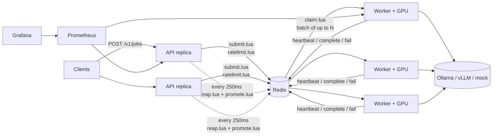
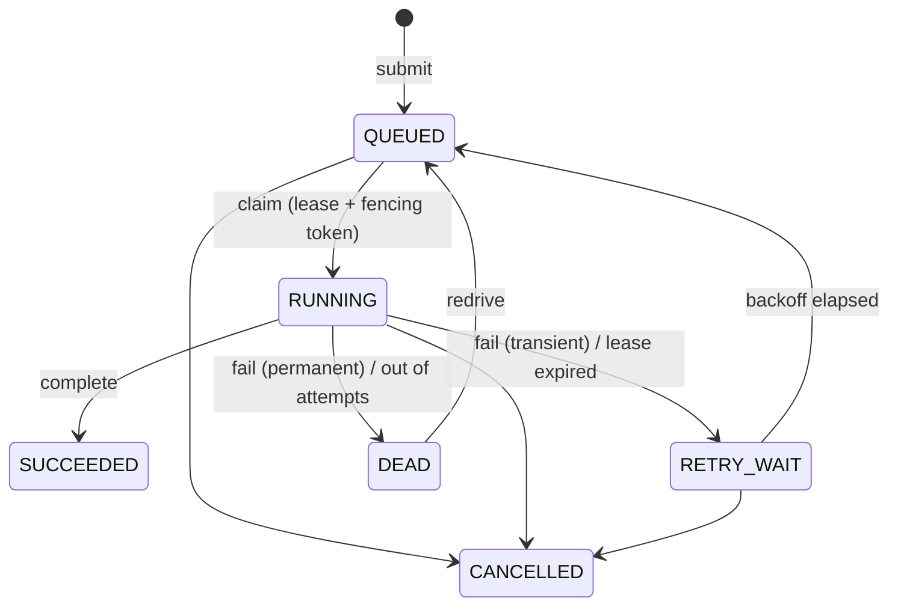

# InferQ: a distributed job queue for LLM inference

InferQ accepts prompts over HTTP, queues them by priority, and schedules them in batches across a pool of GPU workers. It retries failures, recovers jobs from crashed workers, and pushes back on clients when it is overloaded.

- **API and scheduler:** Java 21, Spring Boot 3
- **Queue:** Redis 7, where every state transition is an atomic Lua script
- **Workers:** Python asyncio, using a mock, Ollama or vLLM backend
- **Observability:** Prometheus and Grafana, plus a chaos test and an open-loop benchmark



## Job lifecycle



## Features and the design decision behind each

| Feature | How it works | Why this way |
|---|---|---|
| **Atomic state transitions** | Each transition (submit, claim, complete, fail, reap…) is a single Lua script in [`lua/`](lua). The Java API and the Python workers load the same files. | There's no read-modify-write race between processes, and no distributed lock. Redis runs each script atomically. |
| **Priorities without starvation** | A job's rank is its enqueue time plus a fixed penalty per priority (HIGH 0s, NORMAL 30s, LOW 120s). Workers take the lowest rank first. | Aging comes for free: a LOW job waiting more than 120s outranks a HIGH job that just arrived. One sorted set, O(log n). |
| **Crash recovery** | A worker leases each job it claims and heartbeats while running it. If the worker crashes, the lease expires and the reaper retries the job. | This is at-least-once delivery. Nothing is lost when a worker is SIGKILLed mid-batch, as the chaos test shows. |
| **Fencing tokens** | Every claim bumps a per-job `fence` counter. A complete or fail call carrying an old fence is rejected. | A "zombie" worker (one paused by GC, a network partition or a slow GPU) can't overwrite the result of the worker that took over its job. |
| **Retries** | Capped exponential backoff with equal jitter. Transient errors are retried; permanent errors (such as bad input) go straight to the DLQ. | Jitter prevents a retry stampede after an outage. Classifying errors avoids burning GPU time on requests that can never succeed. |
| **Dead-letter queue and redrive** | `GET /v1/dlq` lists failed jobs, and `POST /v1/dlq/{id}/redrive` requeues one. | Poison messages are kept aside rather than retried forever, and an operator can replay them after a fix. |
| **Dynamic batching** | After claiming the first job, a worker keeps claiming for up to `MAX_WAIT_MS` to fill a batch of `MAX_BATCH`. | A GPU forward pass has a large fixed cost, so batching raises throughput. Under heavy load the batch fills at once, so the wait only happens when traffic is light. |
| **Idempotent submission** | `Idempotency-Key` header, scoped per tenant, kept for 24h. | Clients can safely retry a `POST` after a timeout without creating duplicate jobs. |
| **Rate limiting** | Token bucket per tenant (`X-Tenant-Id`), kept in Redis. Returns `429` with `Retry-After`. | It holds across any number of API replicas, and one noisy tenant can't fill the queue. |
| **Backpressure** | Returns `503` with `Retry-After` once a model's ready queue reaches `max-queue-depth`. | Rejecting early is better than accepting work that would time out anyway. Latency stays bounded. |
| **Graceful shutdown** | On SIGTERM a worker stops claiming, finishes its current batch, then exits. | Deploys and scale-down don't cause retries. |
| **One clock** | Every script reads time from Redis `TIME`. | Clock skew between API and worker hosts can't make leases expire early or late. |
| **Stateless API** | All state is in Redis, and the reaper is safe to run in every replica. | You can scale the API horizontally with no leader election. |

## Quick start

You need Docker. It runs anywhere, with no GPU required, using the mock backend.

```bash
docker compose up -d --build          # Redis, API, 3 workers, Prometheus, Grafana
```

```bash
# submit
curl -s -X POST localhost:8080/v1/jobs \
  -H 'Content-Type: application/json' -H 'X-Tenant-Id: alice' -H 'Idempotency-Key: req-1' \
  -d '{"prompt":"Explain backpressure in one sentence","priority":"high","maxTokens":64}'
# -> 202 {"id":"6f1c…","status":"QUEUED"}

curl -s localhost:8080/v1/jobs/<id>     # status, result, attempts, queueWaitMs, totalLatencyMs
curl -s localhost:8080/v1/stats         # queue depths and counters
curl -s -X DELETE localhost:8080/v1/jobs/<id>
curl -s localhost:8080/v1/dlq
curl -s -X POST localhost:8080/v1/dlq/<id>/redrive
```

- Grafana dashboard: http://localhost:3000. It shows queue depth, throughput, batch size, p50 and p99 latency, rejections and recovery events.
- Prometheus: http://localhost:9090

Scale the workers with `docker compose up -d --scale worker=6`.

## Running on a real GPU

**Ollama:**

```bash
OLLAMA_NUM_PARALLEL=8 ollama serve      # on the host
ollama pull llama3.2:1b
MODEL=llama3.2:1b BACKEND=ollama WORKERS=1 docker compose up -d --build
```

**vLLM** gives true batching, with one request for the whole batch:

```bash
vllm serve Qwen/Qwen2.5-0.5B-Instruct --port 8000
MODEL=qwen BACKEND=vllm BACKEND_MODEL=Qwen/Qwen2.5-0.5B-Instruct \
  BACKEND_URL=http://host.docker.internal:8000 WORKERS=1 docker compose up -d --build
```

## Tests

```bash
make test-lua      # 43 checks of queue semantics against a real Redis
make test-worker   # batching and backend unit tests
make test-api      # Java build and unit tests
```

The Lua tests cover ordering, aging, idempotency, backpressure, fenced completion, retry, DLQ, redrive, lease expiry, zombie rejection, heartbeats, cancel and rate limiting. CI runs all three suites ([`.github/workflows/ci.yml`](.github/workflows/ci.yml)).

## Chaos test: kill workers, lose nothing

```bash
python3 chaos/chaos_test.py --jobs 300 --kill 2
```

The test does four things:

1. Submits 300 jobs with idempotency keys.
2. Re-submits 20 of them and checks that the original IDs come back.
3. SIGKILLs 2 of the 3 workers mid-run, then restarts them.
4. Waits for every job, and checks that none were lost or dead-lettered and that the reaper recovered the jobs from the killed workers.

## Benchmarks

```bash
python3 bench/bench.py --rate 50 --duration 60 --label baseline
make bench-compare        # the same load with MAX_BATCH=1, then MAX_BATCH=8
```

The benchmark is open-loop, so the submission rate doesn't slow down when the system does. It reports:

- throughput
- submit API p99
- queue wait and end-to-end latency at p50, p95 and p99, overall and per priority
- how many requests were rejected with 429 or 503

Each run is appended to `bench/results.jsonl`.

Fill this table in with your own runs, and note your hardware:

| Run | Workers | MAX_BATCH | Offered load | Throughput | e2e p50 | e2e p99 | HIGH p50 vs LOW p50 |
|---|---|---|---|---|---|---|---|
| batching off | 3 | 1 | 40/s | | | | |
| batching on | 3 | 8 | 40/s | | | | |
| overload | 3 | 8 | 200/s | | | | |
| 2 of 3 workers killed | 3 | 8 | 300 jobs | | | | |

To measure submit-API capacity on its own, run `k6 run -e RATE=500 loadtest/submit.js`.

## Configuration

| Variable | Default | Meaning |
|---|---|---|
| `MODEL` | `mock-small` | Model the workers serve. The API accepts only configured models. |
| `BACKEND` | `mock` | `mock`, `ollama` or `vllm` |
| `WORKERS` | `3` | Worker replicas |
| `MAX_BATCH` / `MAX_WAIT_MS` | `8` / `20` | Dynamic batching |
| `LEASE_MS` / `HEARTBEAT_MS` | `10000` / `3000` | Crash detection. A job is recovered about `LEASE_MS` after its worker dies. |
| `FAIL_RATE` | `0` | Mock backend: fraction of transient failures to inject |
| `MAX_QUEUE_DEPTH` | `10000` | Backpressure threshold (503) |
| `RATE_LIMIT_RPS` / `RATE_LIMIT_BURST` | `100` / `200` | Per-tenant token bucket (429) |

More settings, such as backoff and the priority penalties, are in [`api/src/main/resources/application.yml`](api/src/main/resources/application.yml) and [`worker/inferq_worker/config.py`](worker/inferq_worker/config.py).

## Guarantees and known limits

- **At-least-once execution.** A job can run twice if a worker finishes inference but crashes before reporting. Fencing guarantees that only one result is ever recorded.
- **Durability:** Redis runs with AOF `everysec`, so a Redis crash can lose about 1s of writes. For stronger durability, use `appendfsync always`, or a replicated setup with `WAIT`.
- **Single Redis node.** The scripts build key names at runtime, which Redis Cluster doesn't allow. Sharding would mean hash-tagging keys per model (`{model}`) and running one reaper per shard.
- **Polling.** Workers poll with exponential idle backoff (10ms up to 250ms). A blocking claim, such as `BZPOPMIN` followed by the claim script, would cut idle latency further.
- **vLLM batches share one `max_tokens`**, the largest requested in the batch.

## Next steps

- Testcontainers integration tests for the Java service
- Per-tenant fair queuing (deficit round-robin) on top of priorities
- Streaming tokens back to clients over Server-Sent Events
- Autoscaling workers from queue depth with KEDA on Kubernetes
- Model-aware routing for workers that have several models loaded

## Layout

```
lua/          queue core: atomic Lua scripts shared by API and workers
api/          Spring Boot: REST API, rate limiter, reaper/promoter, metrics
worker/       Python asyncio worker: batching, heartbeats, backends, metrics
tests/lua/    queue-semantics tests against a real Redis
chaos/        kill-the-workers test
bench/        open-loop latency/throughput benchmark
loadtest/     k6 script for the submit API
monitoring/   Prometheus scrape config and a provisioned Grafana dashboard
```
